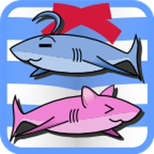

<p align="center"></p>

# Kirikiroid2-NX

**The first port of [Kirikiroid2](https://github.com/zeas2/Kirikiroid2) to the Nintendo Switch** — play KiriKiri2 / KiriKiri Z
(吉里吉里 / krkr) visual novels on a hacked Switch, the same way you play them with Kirikiroid2 on Android.

Kirikiroid2-NX is built from **zeas2's original Kirikiroid2 1.3.9 source code** (not a re-implementation): the same
TJS2 script engine, KAG/KAGEX support, XP3 archives and `xp3filter.tjs` decryption support, and the same
file-selector UI you know from the Android app — running natively as a Switch homebrew `.nro`.

> **Status: v0.1.2-alpha (preview).** Real games already run (video, voice, BGM, text, menus, transitions), but
> this is an early release: some games have save problems and a few features are still missing. See
> [Known issues](#known-issues). Bug reports are very welcome.

## Requirements
- A Nintendo Switch running custom firmware (Atmosphère) — any model (Erista, Mariko, OLED, Lite).
- Launch it in **title-takeover mode** (hold **R** while starting a game, then open the Homebrew Menu), so the
  app gets the full RAM. Applet mode (from the Album) does not have enough memory for most games.

## Installation
1. Download `Kirikiroid2-NX.nro` from the [Releases](../../releases) page.
2. Copy it to `sdmc:/switch/` on your SD card.
3. Start the Homebrew Menu in title-takeover mode and open **Kirikiroid2-NX**.

## Playing a game
- Copy the game folder to the SD card **exactly as you would for Kirikiroid2 on Android** (e.g.
  `sdmc:/kirikiri/<game>/` containing `data.xp3` and the other `.xp3` files). No conversion is needed.
- Browse to it in the file selector and tap `data.xp3` (or the folder with `startup.tjs`).
- Controls: **touchscreen** (like on a phone) and **Joy-Con / Pro Controller** (handheld, attached or wireless):
  A = advance / confirm, B = cancel / right-click, D-pad = select, X / Y / L / R / ZL / ZR / + as on Android
  Kirikiroid2, **left stick = mouse cursor** (A / B click at the cursor), **− = Kirikiroid2 menu**.
- Only use games you legally own. No game data is included in or distributed with this project.

## What works
- Original Kirikiroid2 1.3.9 engine: TJS2, KAG / KAGEX 3, XP3 (incl. `xp3filter.tjs`), auto path, patches.
- Images (PNG, JPEG, TLG, WebP, BPG, JPEG XR), fonts (FreeType, game-bundled TTF), Vietnamese / Japanese / Chinese text.
- Audio (OpenAL: Ogg Vorbis, Opus, WAV, TCWF) and video (FFmpeg 3.2, e.g. MPEG-1 logo movies).
- Transitions: crossfade, universal, scroll **+ extrans** (wave, mosaic, turn, rotatezoom, rotatevanish,
  rotateswap, ripple).
- Layer effects from **layerExImage** (light, colorize, modulate, noise, gaussianBlur).
- **layerExDraw** (GDI+-style vector/text drawing, on Blend2D), **fstat** (file/directory functions) and
  **AlphaMovie** (`.amv` alpha movies).
- Original Kirikiroid2 UI (file selector, preferences), multi-touch, Switch software keyboard for text input.

## Known issues
- System message boxes that ask Yes/No always pick the first button (a proper modal dialog is being written).
- Not yet ported plugins that the Android APK ships: KAGParserEx, E-mote/motion player,
  windowEx, scriptsEx, layerExRaster, shrinkCopy, json, sqlite and others — games that need them may show errors.
- Exiting a game can show "The software was closed because an error occurred".
- Only the software renderer is supported for now.

## How is this different from other KiriKiri projects on Switch?
Other projects bring the KiriKiri engine to the Switch through [krkrsdl2](https://github.com/krkrsdl2/krkrsdl2) /
KiriKiri Z (for example [krkr-ns](https://github.com/DrFlyingPig/krkr-ns)). **Kirikiroid2-NX is a port of the
Kirikiroid2 app itself**, aiming for exact behaviour parity with Kirikiroid2 1.3.9 on Android: any game that runs in
Kirikiroid2 on Android should, eventually, run here too — including its compatibility fixes, `xp3filter.tjs`
support and UI.

## Building
Built with devkitPro (devkitA64 + libnx) on Linux/WSL2. The build scripts live in
[`platforms/switch/tools/`](platforms/switch/tools); they assume a workspace directory (`K2NX_WS`, default
`/mnt/d/Kirikiroid2-Switch`) with this repository checked out as `$K2NX_WS/src`.

```sh
export K2NX_WS=/path/to/workspace          # this repo = $K2NX_WS/src
bash src/platforms/switch/tools/setup_wsl_devkitpro.sh        # toolchain (as root)
bash src/platforms/switch/tools/fetch_cocos.sh                # cocos2d-x 3.11.1 + Switch patches
bash src/platforms/switch/tools/fetch_lzma_sdk.sh             # 7-Zip (p7zip 16.02 + LZMA SDK 16.04)
for s in libiconv ffmpeg opencv unrar libbpg jxrlib blend2d; do       # third-party libs 1.3.9 needs
  bash src/platforms/switch/tools/portlibs/build_$s.sh; done
bash src/platforms/switch/tools/extract_apk_assets.sh         # UI assets + icon from the official 1.3.9 APK
bash src/platforms/switch/tools/build_k2.sh                   # -> kirikiroid2.nro
```

The compiled UI (`.csb`), images and `DroidSansFallback.ttf` are taken at build time from zeas2's official
Kirikiroid2 1.3.9 APK release; they are not stored in this repository. Source changes made for the Switch are
marked with `[K2S]` in the code.

## Credits
- **Erige005** (from Vietnam) — Kirikiroid2-NX creator & maintainer — [github.com/Erige005](https://github.com/Erige005) ·
  gkdm.2k5@gmail.com
- **zeas2** — [Kirikiroid2](https://github.com/zeas2/Kirikiroid2), the Android/iOS port this project is based on.
- **W.Dee and contributors** — KiriKiri2 / KiriKiri Z (吉里吉里).
- **Go Watanabe (wtnbgo)** — layerExImage, layerExDraw, fstat; **krkrz project** — extrans (SamplePlugin);
  **krkr2 project** — POSIX/Blend2D ports of fstat and layerExDraw.
- cocos2d-x, Blend2D, FFmpeg, OpenCV, 7-Zip / p7zip, UnRAR, libbpg, jxrlib, libiconv, FreeType, OpenAL Soft, libnx /
  devkitPro, mesa, GLFW and all other libraries listed in [THIRD_PARTY_LICENSES.md](THIRD_PARTY_LICENSES.md).

## License
Kirikiroid2 and KiriKiri are distributed under the KiriKiri license — see [LICENSE](LICENSE) (unchanged from
upstream). Third-party components keep their own licenses, see [THIRD_PARTY_LICENSES.md](THIRD_PARTY_LICENSES.md).

This project is not affiliated with Nintendo, zeas2 or the KiriKiri developers.
